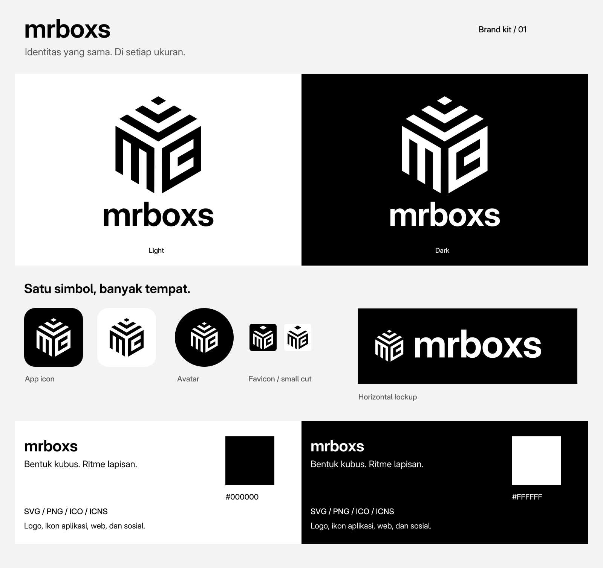

# mrboxs brand kit

**English** | [Bahasa Indonesia](README.id.md)

A digital identity kit built from the original `mrboxs-logo.svg` supplied by mrboxs. The original symbol is preserved. The exports remove Illustrator metadata, separate the symbol from its background, and add a wordmark and variants for different sizes and uses.

[Download the latest release](https://github.com/mrboxs/mrboxs-brandkit/releases/latest)

Start with the [brand overview](05-guidelines/brand-overview.png) to see the kit. Detailed [brand guidelines](05-guidelines/brand-guidelines.md) and the [QA report](05-guidelines/qa-report.md) are available in Indonesian; this README covers asset selection, installation, and usage in English.



## Choose an asset

| Use | File / directory |
|---|---|
| Logo on a light background | `01-logos/light/` (black artwork, transparent background) |
| Logo on a dark background | `01-logos/dark/` (white artwork, transparent background) |
| Logo that follows the system theme | `01-logos/adaptive/` |
| Logo that inherits a CSS color | `01-logos/inline/` (embed the SVG directly in HTML/JSX) |
| Navigation bar logo | `mrboxs-horizontal.svg` |
| Name only | `mrboxs-wordmark.svg` |
| Vertical layout | `mrboxs-stacked.svg` |
| Badge matching the original logo | `mrboxs-badge.svg` |
| Favicon and PWA icons | `02-icons/web/` |
| Square and rounded app icons | `02-icons/app/light/` or `dark/` |
| Windows / macOS | `mrboxs-windows.ico` / `mrboxs-macos.icns` |
| iOS | `02-icons/app/ios/<theme>/AppIcon.appiconset/` |
| Android, including themed icons | `02-icons/app/android/res/` |
| Avatars and social cards | `03-social/<theme>/` |
| CSS, color tokens, and patterns | `04-brand/` |
| Guidelines and verification results | `05-guidelines/` |
| Font and OFL license | `06-typography/` |
| Original source | `00-source/mrboxs-logo-original.svg` |

`light` and `dark` describe the **background the asset is intended for**. Light-theme logos use black artwork; dark-theme logos use white artwork. Icons, avatars, and social cards include their own backgrounds.

The full symbol retains the original geometry. The small-size variant removes the middle upper chevron and enlarges the diamond for clearer rendering at 16–32 px. Use the full symbol at larger sizes.

## Website installation

Copy these directories into your project's public directory:

```text
02-icons/web/    -> public/brand/icons/
01-logos/       -> public/brand/logos/
03-social/      -> public/brand/social/
04-brand/       -> public/brand/system/
06-typography/  -> public/brand/typography/
```

1. Add [`02-icons/web/head-snippet.html`](02-icons/web/head-snippet.html) to your page's `<head>`.
2. Load `/brand/system/brand.css` if you want to use the supplied tokens and font.
3. Use [`01-logos/logo-snippet.html`](01-logos/logo-snippet.html), or embed a `currentcolor` SVG directly as inline SVG.
4. For a manual theme, set `<html data-theme="light">` or `<html data-theme="dark">`. Remove the attribute or set it to `system` to follow the operating system. The optional `theme-sync.js` adapter synchronizes the favicon and browser chrome color with this attribute.
5. Use the 1200×630 social card for `og:image` and `twitter:image`. Set an absolute HTTPS URL on your own domain after uploading the image. Use `twitter:card=summary_large_image`, `og:image:width=1200`, `og:image:height=630`, and image alt text such as `mrboxs logo`.

The snippets use `/brand/` paths. Adjust this prefix if your site is deployed under a subpath. Manifest icon URLs are relative to the manifest file, while `id`, `start_url`, and `scope` default to `/`; update all three for your application before deployment. This asset kit does not include a service worker or a PWA application.

### System and manual themes

The `adaptive/*-auto.svg` files and automatic favicon respond to **system theme preferences**. They do not automatically read your application's manual theme setting. For manual themes, use the supplied CSS, inline SVG with `currentColor`, or the light/dark asset pair. An external SVG loaded through `` does not inherit `currentColor` from its parent element.

The head snippet selects dark icons consistently for installation. A light manifest is also available. Installed PWA icons, Apple Touch Icons, and ordinary desktop icons are not guaranteed to change when the theme changes; favicon switching applies to browser tabs. Choose your preferred installation variant before release.

## Native applications

- **iOS:** choose one light/dark `AppIcon.appiconset` and add it to your Xcode asset catalog. All iOS PNGs are opaque and square; the system applies the corner mask. These are separate alternatives selected at build time, rather than a single catalog that automatically changes with the iOS theme.
- **Android:** merge `android/res/` into your application's resources and set `android:icon="@mipmap/ic_launcher"` and `android:roundIcon="@mipmap/ic_launcher_round"` in the application manifest. Check for resource name conflicts before merging. Adaptive icons are provided for API 26+, monochrome icons for API 33+, and raster fallbacks for older versions. Day/night colors are included; launchers may cache icons or apply wallpaper colors to themed icons.
- **Windows:** use the multi-resolution `.ico` file. Select light or dark when packaging.
- **macOS:** use the `.icns` file. Both themes are available as packaging alternatives; they do not switch automatically.
- **App stores and launchers:** use the unmasked 1024 px square PNG when the platform applies its own mask. Rounded PNGs are suitable for presentations and placements without a platform mask.

## Rebuild the kit

Requirements: Python 3, `fonttools`, `Pillow`, and `rsvg-convert` (librsvg). Once dependencies are installed, the asset build does not require a browser or network access.

```sh
python3 -m venv .venv
.venv/bin/pip install fonttools pillow
.venv/bin/python tools/build.py
.venv/bin/python tools/verify.py
# Optional: requires Chromium; checks browser theme switching without a server.
.venv/bin/python tools/check-browser.py
.venv/bin/python tools/package.py
```

Run these commands from the kit directory. The scripts locate the source artwork and font relative to their own paths, so they do not depend on locally installed fonts. `tools/build.py` updates generated assets; READMEs, guidelines, CSS, and snippets are maintained as source files. After verification, `tools/package.py` refreshes the inventory, checksums, and ZIP archive.

## Verification and rights

The kit includes file-integrity checks, transparency checks, icon-container checks, safe-zone checks, text contrast calculations, and Chromium theme tests. See [`verification.json`](05-guidelines/verification.json) and [`browser-verification.json`](05-guidelines/browser-verification.json) for results. Native icons have not been installed on physical devices, and no Xcode/Android SDK builds or print proofs were performed.

Adwaita Sans is distributed under SIL OFL 1.1; see [`06-typography/OFL.txt`](06-typography/OFL.txt). The wordmark is outlined, so opening the SVG does not require an installed font. This kit does not change ownership or licensing of the original mrboxs logo.
